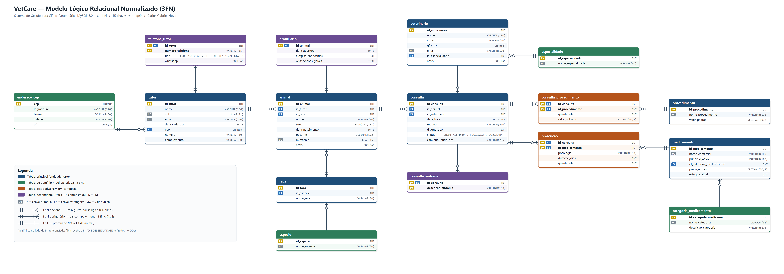
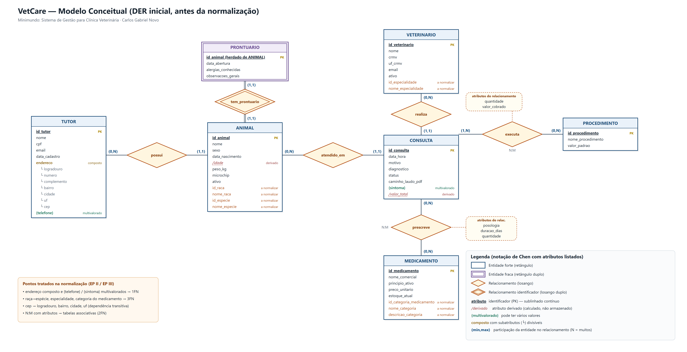
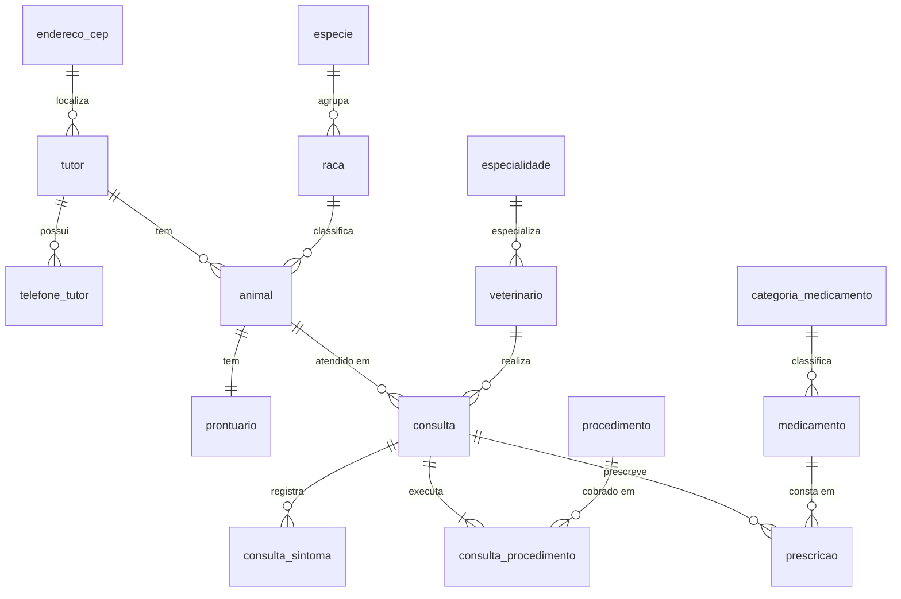

# VetCare — Modelagem de Banco de Dados Relacional (MySQL 8.0)

Modelagem completa de um banco de dados relacional para gestão de clínica veterinária, cobrindo levantamento de requisitos, DER conceitual (notação de Chen), normalização formal até a **Terceira Forma Normal (3FN)**, implementação física em **MySQL 8.0**, consultas analíticas, transação com lock pessimista e validação automatizada em CI.

[](https://github.com/cgn2222/ads-modelagem-bd-vetcare/actions/workflows/ci.yml)




---

## Sumário

1. [Problema e escopo](#problema-e-escopo)
2. [Jornada de modelagem](#jornada-de-modelagem)
3. [Diagramas](#diagramas)
4. [As 16 tabelas por domínio](#as-16-tabelas-por-domínio)
5. [Como executar](#como-executar)
6. [Consultas analíticas e automação](#consultas-analíticas-e-automação)
7. [Integridade referencial e validação automatizada (CI)](#integridade-referencial-e-validação-automatizada-ci)
8. [Decisões de arquitetura e trade-offs](#decisões-de-arquitetura-e-trade-offs)
9. [Estrutura do repositório](#estrutura-do-repositório)
10. [Créditos](#créditos)

---

## Problema e escopo

Clínicas veterinárias de pequeno e médio porte frequentemente operam com fichas físicas e planilhas isoladas, gerando inconsistências clássicas: endereços duplicados, raças grafadas de múltiplas formas, ausência de histórico de preços cobrados em procedimentos e falta de controle sobre o estoque de medicamentos.

O **VetCare** modela esse domínio em **16 tabelas normalizadas em 3FN** (15 chaves estrangeiras), cobrindo o ciclo clínico ponta a ponta:

| Dimensão | Definição |
| --- | --- |
| **Atores** | Recepcionista, Veterinário, Gerente e Tutor (ator externo) |
| **Fluxo principal** | Cadastro e agendamento → Atendimento clínico (sintomas, procedimentos, prescrições) → Fechamento e controle de estoque |
| **No escopo** | Cadastros de tutores/animais/veterinários, prontuário 1:1, consultas, procedimentos com valor histórico, prescrições, estoque e relatórios SQL |
| **Fora do escopo** | Emissão fiscal/meios de pagamento, internação hospitalar, pet shop, autenticação/RBAC e telemedicina |

Documentação completa de requisitos: [`docs/01-minimundo-e-requisitos.md`](docs/01-minimundo-e-requisitos.md)

---

## Jornada de modelagem


| Etapa | Transformação aplicada | Resultado |
| --- | --- | --- |
| **Conceitual** | DER de Chen com entidades fortes/fracas, atributos compostos, multivalorados e derivados | 7 entidades, 6 relacionamentos |
| **1FN** | Endereço composto decomposto; `telefones` e `sintomas` multivalorados extraídos | `telefone_tutor`, `consulta_sintoma` |
| **2FN** | Relacionamentos N:M convertidos em associativas; atributos dependentes de parte da PK isolados nos catálogos | `consulta_procedimento`, `prescricao` |
| **3FN** | Dependências transitivas (`cep`, espécie/raça, especialidade, categoria) extraídas para tabelas de domínio | `endereco_cep`, `especie`, `raca`, `especialidade`, `categoria_medicamento` |
| **Físico** | DDL com `InnoDB`, `utf8mb4`, `DECIMAL(10,2)`, `UNIQUE`, `CHECK`, índices compostos, views, stored procedure e CI | 16 tabelas · 15 FKs · 3 views · 1 procedure |

Passo a passo formal com dependências funcionais: [`docs/03-normalizacao-1fn-2fn-3fn.md`](docs/03-normalizacao-1fn-2fn-3fn.md)

---

## Diagramas

### 1. DER conceitual inicial (notação de Chen)


### 2. Modelo lógico relacional em 3FN (16 tabelas)


> Também disponível em [`diagrams/02-der-revisado.png`](diagrams/02-der-revisado.png): DER conceitual revisado após a normalização (14 entidades, 13 relacionamentos).

Visão resumida dos relacionamentos em Mermaid:



---

## As 16 tabelas por domínio

| Domínio | Tabela | Papel | Chave primária |
| --- | --- | --- | --- |
| **Cadastros (4)** | `tutor` | Responsável pelo animal (CPF único com validação de formato) | `id_tutor` |
| | `telefone_tutor` | Telefones do tutor (entidade fraca, `ON DELETE CASCADE`) | `(id_tutor, numero_telefone)` |
| | `animal` | Paciente (idade derivada de `data_nascimento`) | `id_animal` |
| | `veterinario` | Profissional (`UNIQUE(crmv, uf_crmv)`) | `id_veterinario` |
| **Clínico (5)** | `prontuario` | Ficha clínica 1:1 identificada pelo animal | `id_animal` (`PK = FK`) |
| | `consulta` | Evento clínico (`valor_total` derivado) | `id_consulta` |
| | `consulta_sintoma` | Sintomas relatados (entidade fraca, `ON DELETE CASCADE`) | `(id_consulta, descricao_sintoma)` |
| | `consulta_procedimento` | Procedimentos executados e preço praticado na data (N:M) | `(id_consulta, id_procedimento)` |
| | `prescricao` | Medicamentos prescritos, posologia e duração (N:M) | `(id_consulta, id_medicamento)` |
| **Domínio / Catálogos (7)** | `endereco_cep` | CEP → logradouro, bairro, cidade, UF | `cep` |
| | `especie` | Espécies atendidas | `id_especie` |
| | `raca` | Raças vinculadas à espécie (`UNIQUE(id_especie, nome_raca)`) | `id_raca` |
| | `especialidade` | Especialidades veterinárias | `id_especialidade` |
| | `procedimento` | Catálogo de serviços e `valor_padrao` | `id_procedimento` |
| | `categoria_medicamento` | Classificação terapêutica | `id_categoria_medicamento` |
| | `medicamento` | Catálogo com `preco_unitario` e `estoque_atual` | `id_medicamento` |

Dicionário completo das 16 tabelas e 75 colunas: [`docs/04-dicionario-de-dados.md`](docs/04-dicionario-de-dados.md)

---

## Como executar

> **Requisito:** MySQL **8.0.16+** (necessário para aplicação efetiva de cláusulas `CHECK` e `DEFAULT (CURRENT_DATE)`). Todos os dados do seed são fictícios.

### Opção 1 — Docker Compose

```bash
docker compose up -d
docker exec -it vetcare-mysql mysql -uroot -pvetcare_dev vetcare
```

Para executar a suíte completa de verificação contra o container local:

```bash
bash tests/verify_mysql.sh
```

Para recriar o banco do zero:

```bash
docker compose down -v && docker compose up -d
```

### Opção 2 — MySQL CLI ou MySQL Workbench

```bash
mysql -u root -p < sql/01_ddl_schema.sql
mysql -u root -p < sql/02_dml_seed.sql
mysql -u root -p < sql/03_dql_queries.sql
mysql -u root -p < sql/05_procedures_and_explain.sql
mysql -u root -p < sql/04_dml_updates_deletes.sql
```

Para executar schema, seed, views/consultas e DML de uma única vez:

```bash
mysql -u root -p < sql/vetcare_completo.sql
```

### Opção 3 — DB-Fiddle (sem instalação local)

1. Acesse [db-fiddle.com](https://www.db-fiddle.com/) e selecione **MySQL 8.0**.
2. Em **Schema SQL**, cole `sql/01_ddl_schema.sql` e `sql/02_dml_seed.sql` *(remova as linhas `DROP/CREATE DATABASE` e `USE` caso o sandbox já selecione o banco automaticamente)*.
3. Em **Query SQL**, execute consultas de `sql/03_dql_queries.sql`.

---

## Consultas analíticas e automação

### Exemplo 1 — Valor total por consulta (`SUM` + `GROUP BY` + `HAVING`)

```sql
SELECT c.id_consulta,
       a.nome                                AS animal,
       DATE(c.data_hora)                     AS data_consulta,
       COUNT(cp.id_procedimento)             AS qtd_procedimentos,
       SUM(cp.quantidade * cp.valor_cobrado) AS valor_total
FROM consulta c
INNER JOIN animal                a  ON a.id_animal    = c.id_animal
INNER JOIN consulta_procedimento cp ON cp.id_consulta = c.id_consulta
WHERE c.status = 'REALIZADA'
GROUP BY c.id_consulta, a.nome, DATE(c.data_hora)
HAVING SUM(cp.quantidade * cp.valor_cobrado) > 250
ORDER BY valor_total DESC
LIMIT 5;
```

| id_consulta | animal | data_consulta | qtd_procedimentos | valor_total |
| :---: | --- | :---: | :---: | ---: |
| 5 | Max | 2025-11-05 | 3 | 650.00 |
| 8 | Pipoca | 2026-01-14 | 2 | 540.00 |
| 4 | Bidu | 2025-10-20 | 2 | 480.00 |
| 13 | Max | 2026-06-09 | 2 | 470.00 |
| 12 | Bidu | 2026-05-14 | 2 | 300.00 |

### Exemplo 2 — Produtividade por veterinário em 2026 (`LEFT JOIN` + múltiplas agregações)

```sql
SELECT v.nome                                             AS veterinario,
       esp.nome_especialidade                             AS especialidade,
       COUNT(DISTINCT c.id_consulta)                      AS consultas_realizadas,
       COALESCE(SUM(cp.quantidade * cp.valor_cobrado), 0) AS receita_procedimentos
FROM veterinario v
INNER JOIN especialidade esp ON esp.id_especialidade = v.id_especialidade
LEFT  JOIN consulta c  ON c.id_veterinario = v.id_veterinario
                      AND c.status = 'REALIZADA'
                      AND c.data_hora >= '2026-01-01' AND c.data_hora < '2027-01-01'
LEFT  JOIN consulta_procedimento cp ON cp.id_consulta = c.id_consulta
GROUP BY v.id_veterinario, v.nome, esp.nome_especialidade
ORDER BY receita_procedimentos DESC;
```

| veterinario | especialidade | consultas_realizadas | receita_procedimentos |
| --- | --- | :---: | ---: |
| Dra. Helena Duarte | Clínica Geral | 4 | 1160.00 |
| Dra. Camila Ferraz | Cardiologia | 1 | 470.00 |
| Dr. André Siqueira | Ortopedia | 1 | 300.00 |
| Dr. Rafael Monteiro | Dermatologia | 2 | 240.00 |

### Views, Stored Procedure e análise de índices

- **3 Views reutilizáveis** em [`sql/03_dql_queries.sql`](sql/03_dql_queries.sql): `vw_consulta_valor_total`, `vw_estoque_critico` e `vw_historico_clinico`, além de 13 consultas analíticas cobrindo anti-joins (`LEFT JOIN ... IS NULL`), subconsultas escalares e séries mensais.
- **Stored Procedure transacional** em [`sql/05_procedures_and_explain.sql`](sql/05_procedures_and_explain.sql): `sp_registrar_prescricao_e_baixar_estoque` utiliza `SELECT ... FOR UPDATE` (bloqueio pessimista), impede prescrição em consulta `CANCELADA`, valida estoque disponível e realiza `INSERT` + baixa de estoque atomicamente com rollback automático em erro.
- **Planos de execução (`EXPLAIN`)** no mesmo arquivo inspecionam o uso dos índices `ix_consulta_status_data`, `uq_tutor_cpf`, `ix_medicamento_estoque` e da chave primária composta de `consulta_procedimento`.

---

## Integridade referencial e validação automatizada (CI)

O workflow [`.github/workflows/ci.yml`](.github/workflows/ci.yml) sobe um serviço real de **MySQL 8.0** no GitHub Actions a cada push/PR e executa [`tests/verify_mysql.sh`](tests/verify_mysql.sh), validando:

1. Criação das **16 tabelas**, **15 FKs**, **3 views** e contagens exatas de registros do seed.
2. Execução de todas as consultas analíticas (`ONLY_FULL_GROUP_BY` ativo por padrão no MySQL 8.0).
3. Fluxo positivo e negativo da procedure `sp_registrar_prescricao_e_baixar_estoque` (baixa atômica, rejeição de estoque insuficiente com rollback e bloqueio em consulta cancelada).
4. **Testes negativos de constraints** (garantindo que o banco rejeite operações inválidas):
   - `DELETE FROM tutor WHERE id_tutor = 1` → bloqueado (`ERROR 1451` — `ON DELETE RESTRICT`)
   - `UPDATE medicamento SET estoque_atual = -1 WHERE id_medicamento = 1` → bloqueado (`ERROR 3819` — `ck_med_estoque`)
   - CPF duplicado → bloqueado (`ERROR 1062` — `uq_tutor_cpf`)
   - CPF fora do padrão de 11 dígitos → bloqueado (`ERROR 3819` — `ck_tutor_cpf_formato`)
5. Transações com `COMMIT` e `ROLLBACK` em `sql/04_dml_updates_deletes.sql` e smoke test final de `sql/vetcare_completo.sql`.

---

## Decisões de arquitetura e trade-offs

Todo modelo relacional envolve escolhas conscientes entre rigor teórico e demandas operacionais de produção:

| Decisão no modelo | Justificativa adotada | Evolução recomendada em produção |
| --- | --- | --- |
| **`endereco_cep` com `cep` como PK** | Demonstra formalmente a eliminação da dependência transitiva `cep → logradouro, bairro, cidade, uf` (3FN) para CEPs urbanos por logradouro. | Para cobertura nacional incluindo municípios com **CEP único geral**, evoluir para tabela `municipio` + `endereco` com chave surrogate (`id_endereco`). |
| **`consulta_sintoma` com `descricao_sintoma` na PK** | Resolve o atributo multivalorado da 1FN sem criar tabela de vocabulário controlado fora do escopo inicial. | Substituir texto livre por catálogo padronizado `sintoma(id_sintoma, nome)` (ex.: terminologia clínica veterinária) para evitar variações ortográficas. |
| **Preço congelado em `consulta_procedimento.valor_cobrado`** | Desacopla o faturamento histórico de futuros reajustes em `procedimento.valor_padrao`. | Em sistemas com faturamento fiscal, vincular a uma tabela de `fatura` / `item_fatura`. |
| **Baixa direta em `medicamento.estoque_atual`** | Mantém o esquema enxuto, com proteção contra concorrência via `SELECT ... FOR UPDATE` na stored procedure e `CHECK (estoque_atual >= 0)`. | Para rastreabilidade contábil/sanitária completa, introduzir uma tabela append-only `movimentacao_estoque` (entradas, saídas, lotes e validades). |
| **Colunas de auditoria omitidas** | Evita ruído nas demonstrações de 1FN/2FN/3FN e no dicionário didático. | Adicionar `created_at` e `updated_at` (`TIMESTAMP`) e soft-delete padronizado nas tabelas transacionais. |

---

## Estrutura do repositório

```text
ads-modelagem-bd-vetcare/
├── .github/workflows/ci.yml           # Pipeline CI com MySQL 8.0 real
├── README.md
├── LICENSE                            # MIT
├── .gitignore
├── docker-compose.yml                 # MySQL 8.0 com DDL + seed automáticos
├── diagrams/
│   ├── 01-der-conceitual.png          # DER inicial (Chen)
│   ├── 02-der-revisado.png            # DER revisado pós-normalização
│   └── 03-der-logico-3fn.png          # Modelo lógico relacional em 3FN
├── docs/
│   ├── 01-minimundo-e-requisitos.md
│   ├── 02-modelo-conceitual.md
│   ├── 03-normalizacao-1fn-2fn-3fn.md
│   └── 04-dicionario-de-dados.md
├── sql/
│   ├── 01_ddl_schema.sql              # DDL: 16 tabelas, PK/FK/UNIQUE/CHECK/índices
│   ├── 02_dml_seed.sql                # Seed coerente das 16 tabelas
│   ├── 03_dql_queries.sql             # 3 views + 13 consultas analíticas
│   ├── 04_dml_updates_deletes.sql     # 6 UPDATE + 6 DELETE transacionais
│   ├── 05_procedures_and_explain.sql  # Stored procedure com FOR UPDATE + EXPLAIN
│   └── vetcare_completo.sql           # Script consolidado (01 → 04)
└── tests/
    └── verify_mysql.sh                # Suíte automatizada de verificação MySQL 8.0
```

---

## Créditos

Desenvolvido por **Carlos Gabriel Novo** no curso superior de tecnologia em **Análise e Desenvolvimento de Sistemas** (Cruzeiro do Sul Virtual, 2026) — disciplina de *Modelagem de Banco de Dados*.

Distribuído sob licença **MIT** ([`LICENSE`](LICENSE)). Todos os registros presentes nos scripts são fictícios.
