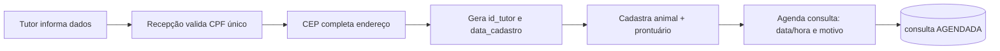

# 01 — Minimundo e Requisitos

> **VetCare — Sistema de Gestão para Clínica Veterinária**
> Primeira etapa da jornada de modelagem: entender o negócio antes de desenhar qualquer tabela.

**Navegação:** **01 Minimundo** · [02 Modelo conceitual](02-modelo-conceitual.md) · [03 Normalização](03-normalizacao-1fn-2fn-3fn.md) · [04 Dicionário de dados](04-dicionario-de-dados.md)

---

## 1. Visão geral

O **VetCare** é um sistema de banco de dados para a gestão de uma clínica veterinária de pequeno e médio porte, usado por **recepcionistas, veterinários e gerentes** e voltado ao atendimento de **tutores e seus animais**. Ele centraliza cadastros, agendamento e registro de consultas, procedimentos, prescrições e estoque de medicamentos.

**Propósito:** substituir fichas de papel e planilhas por dados **íntegros, sem redundância e rastreáveis**.

## 2. Objetivos do sistema

1. **Gerenciar** o cadastro de tutores, animais e prontuários com dados íntegros, sem duplicidade e em conformidade com a LGPD.
2. **Registrar** cada consulta com sintomas, diagnóstico, procedimentos realizados e medicamentos prescritos, vinculando animal e veterinário responsável.
3. **Facilitar** o acompanhamento do histórico clínico, do estoque de medicamentos e do faturamento por consulta e por veterinário.

## 3. Escopo

### 3.1 Dentro do escopo (o que o sistema faz)

| # | Funcionalidade |
|:-:|---|
| 1 | Cadastro de **tutores** (dados pessoais, endereço e múltiplos telefones de contato). |
| 2 | Cadastro de **animais** (espécie, raça, sexo, nascimento, peso, microchip) vinculados a um tutor, com **um prontuário clínico por animal**. |
| 3 | Cadastro de **veterinários** (CRMV/UF, e-mail, especialidade). |
| 4 | **Agendamento e registro de consultas** (data/hora, motivo, sintomas relatados, diagnóstico, status `AGENDADA`/`REALIZADA`/`CANCELADA` e caminho do laudo em PDF). |
| 5 | **Catálogo de procedimentos** (consulta, vacinas, exames, cirurgias simples) e registro dos procedimentos executados em cada consulta, com quantidade e valor efetivamente cobrado. |
| 6 | **Catálogo de medicamentos** por categoria, controle de estoque e registro das **prescrições** (posologia, duração e quantidade) por consulta. |
| 7 | **Consultas e relatórios:** histórico do animal, valor total por consulta, produtividade por veterinário e medicamentos mais prescritos. |
| 8 | **Regras de integridade:** CPF e CRMV únicos, valores monetários em `DECIMAL`, quantidades positivas e exclusões protegidas por chave estrangeira. |

### 3.2 Fora do escopo (decisão de simplicidade e viabilidade)

1. Emissão de nota fiscal, cobrança, parcelamento e conciliação bancária (apenas o valor cobrado por procedimento é registrado).
2. Internação, centro cirúrgico, hospedagem (pet hotel) e banho/tosa.
3. Venda de produtos de pet shop e controle de compras/fornecedores (somente o estoque de medicamentos usados em prescrições).
4. Armazenamento do conteúdo binário de imagens, radiografias e PDFs no banco (guarda-se apenas o caminho do arquivo).
5. Integração com sistemas externos (WhatsApp, planos de saúde pet, vigilância sanitária) e aplicativo móvel para tutores.
6. Gestão de funcionários, folha de pagamento, agenda de salas e controle de acesso/permissões de usuários do sistema.
7. Telemedicina, prontuário eletrônico com assinatura digital e emissão de carteira de vacinação.

## 4. Atores

| Ator | Papel e responsabilidades |
|---|---|
| **Recepcionista** | Cadastra e atualiza tutores, telefones e animais; agenda, reagenda e cancela consultas; consulta histórico e status dos atendimentos. **Não** altera diagnósticos nem prescrições. |
| **Veterinário** | Realiza a consulta: registra sintomas, diagnóstico, procedimentos executados e prescrições; consulta e atualiza o prontuário e anexa o laudo (caminho do PDF). |
| **Gerente / Administrador** | Mantém catálogos (procedimentos, medicamentos, categorias, especialidades), controla o estoque, define valores padrão e consulta relatórios de faturamento e produtividade. |
| **Tutor** *(ator externo)* | Responsável pelo animal; fornece seus dados e os do animal, relata sintomas, autoriza procedimentos e recebe orientações e prescrições. **Não** acessa o banco diretamente. |

## 5. Processos principais

Para cada processo, destacam-se os dados **coletados**, **validados** e **gerados**.

### Processo 1 — Cadastro e agendamento

- **Coletados:** nome, CPF, e-mail, endereço (CEP, número, complemento), telefones; dados do animal (nome, espécie, raça, sexo, nascimento, peso, microchip); data/hora e motivo.
- **Validados:** unicidade do CPF; vínculo animal ↔ tutor; disponibilidade do veterinário.
- **Gerados:** `id_tutor`, data de cadastro, `id_animal`, prontuário, consulta com status `AGENDADA`.

### Processo 2 — Atendimento clínico

- **Coletados:** sintomas relatados, peso atual, diagnóstico, procedimentos (quantidade e valor cobrado) e prescrições (medicamento, posologia, duração em dias, quantidade).
- **Validados:** valor cobrado não negativo; quantidades positivas.
- **Gerados:** status `REALIZADA`; caminho do laudo em PDF quando houver exame.

### Processo 3 — Fechamento e controle de estoque

- Ao concluir o atendimento, o sistema calcula o **valor total** da consulta (`SUM(quantidade × valor_cobrado)`), gera a informação de faturamento e dá **baixa no estoque** dos medicamentos dispensados, validando que o estoque **não fique negativo**.
- O gerente consulta relatórios consolidados (produtividade por veterinário, medicamentos mais prescritos e itens com estoque baixo) para repor medicamentos e ajustar preços.

## 6. Levantamento preliminar de entidades

| Entidade | Por que guardar dados |
|---|---|
| **Tutor** | Responsável financeiro e legal pelo animal; sem ele não há contato, endereço nem responsabilização. Dados pessoais protegidos pela LGPD. |
| **Animal** | Paciente atendido; centro do histórico clínico. Vinculado a um único tutor. |
| **Prontuário** | Ficha clínica única de cada animal (abertura, alergias, observações): continuidade do cuidado e rastreabilidade jurídica. |
| **Veterinário** | Profissional habilitado (CRMV) responsável pelas consultas; permite atribuir responsabilidade técnica e medir produtividade. |
| **Consulta** | Evento central: relaciona animal e veterinário em data/hora; registra motivo, sintomas, diagnóstico, status e laudo; origina procedimentos e prescrições. |
| **Procedimento** | Serviço oferecido e cobrado; o catálogo padroniza preços e registra o que foi executado. |
| **Medicamento** | Item prescrito e controlado em estoque; necessário para prescrições seguras e reposição planejada. |

> Estas **7 entidades** formam o DER conceitual inicial ([`diagrams/01-der-conceitual.png`](../diagrams/01-der-conceitual.png)); a normalização as expande para **16 tabelas** (ver [03](03-normalizacao-1fn-2fn-3fn.md)).

## 7. Dado × Informação

Um **dado** é um fato bruto e isolado; uma **informação** surge quando o dado é processado e contextualizado.

| Dado bruto | Informação gerada | Contextualização aplicada |
|---|---|---|
| `data_nascimento = 2019-05-12` | Idade do animal em anos | Comparação com a data atual (contexto temporal); orienta vacinas e protocolos. |
| `peso_kg = 32,40` (isolado) | Evolução de peso: +0,70 kg desde a última pesagem | Vinculado ao animal e à série histórica; indica ganho de peso e alerta de obesidade. |
| `quantidade = 2; valor_cobrado = 180,00` | Valor total do procedimento: R$ 360,00 | Processamento (multiplicação) e vínculo ao procedimento/consulta. |
| `estoque_atual = 25` (Bravecto) | Alerta: estoque abaixo do nível mínimo | Comparação com um mínimo de reposição; apoia a decisão de compra. |
| `status = 'AGENDADA'` com `data_hora` no passado | Consulta atrasada, aguardando atualização | Combinação de status com a data corrente revela pendência operacional. |
| `COUNT(*) = 4` prescrições de *Analgésico e anti-inflamatório* | Categoria mais prescrita no período | Agregação por categoria; apoia o planejamento de estoque. |
| `cep = 01310100` | Bairro e cidade: Bela Vista, São Paulo/SP | Cruzamento com a tabela de endereços; apoia análises de origem dos clientes. |

## 8. Dados estruturados × não estruturados

| Exemplo | Classe | Justificativa técnica |
|---|---|---|
| Cadastro de tutor (nome, CPF, e-mail, data) | **Estruturado** | Formato fixo e tipos definidos (`VARCHAR`, `CHAR`, `DATE`), em tabela relacional com PK e `UNIQUE`. |
| Peso, sexo e nascimento do animal | **Estruturado** | Valores padronizados (`DECIMAL`, `ENUM`, `DATE`) que permitem filtro, ordenação e cálculo por SQL. |
| Procedimentos realizados (quantidade, valor) | **Estruturado** | Linhas de tabela associativa com tipos numéricos exatos e chave composta; ideais para somas. |
| Prescrição (medicamento, duração, quantidade) | **Estruturado** | Campos discretos e tipados, ligados por FK ao medicamento. |
| Status da consulta | **Estruturado** | Domínio fechado (`ENUM`), padroniza e facilita filtros. |
| Laudos em PDF e radiografias | **Não estruturado** | Arquivos binários sem esquema fixo; ficam fora do banco, que guarda só o caminho (`caminho_laudo_pdf`). |
| Texto livre de diagnóstico e observações | **Não estruturado** | Texto narrativo sem padronização; coluna `TEXT`, consultada por busca textual. |
| Áudios/fotos enviados pelo tutor | **Não estruturado** | Mídia sem formato padronizado; mantida fora do banco com referência opcional. |
| Resultado de exame laboratorial em JSON | **Semiestruturado** | Chave-valor, mas com estrutura variável entre exames; arquivo ou coluna `JSON`, sem esquema relacional fixo. |

## 9. Premissas assumidas

Consolidadas no [modelo conceitual](02-modelo-conceitual.md#6-premissas-e-decisões-de-projeto), entre elas: todo animal pertence a exatamente um tutor e possui um prontuário; cada consulta tem um único veterinário e um único animal; arquivos ficam fora do banco.

---

**Próximo passo →** [02 — Modelo conceitual](02-modelo-conceitual.md)
