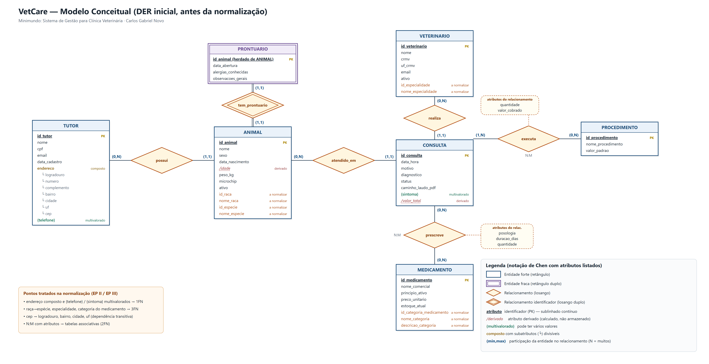
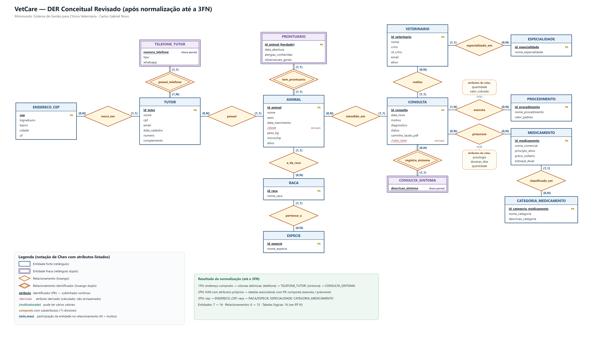
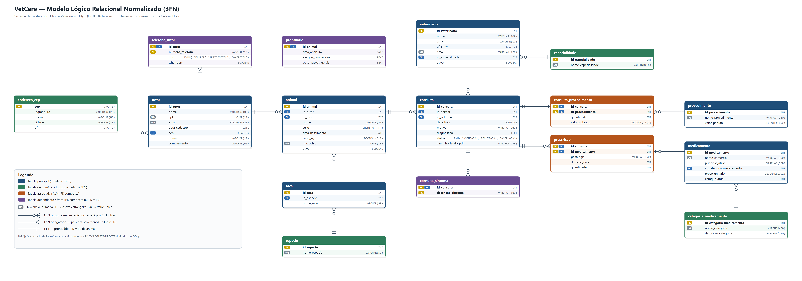

# 02 — Modelo Conceitual (DER)

> Do minimundo ao **Diagrama Entidade-Relacionamento**: entidades fortes e fracas, atributos, relacionamentos e cardinalidades.

**Navegação:** [01 Minimundo](01-minimundo-e-requisitos.md) · **02 Modelo conceitual** · [03 Normalização](03-normalizacao-1fn-2fn-3fn.md) · [04 Dicionário de dados](04-dicionario-de-dados.md)

---

## 1. DER conceitual inicial (antes da normalização)

Notação de **Chen** com atributos listados e cardinalidades `(mín,máx)`: **7 entidades** e **6 relacionamentos**.

## 2. Entidades e atributos

| Entidade | Tipo | Identificador | Atributos |
|---|---|---|---|
| **TUTOR** | Forte | `id_tutor` | `nome`, `cpf` (único), `email` (único), `data_cadastro`, `endereco` **(composto)**: logradouro, número, complemento, bairro, cidade, UF, CEP; `{telefone}` **(multivalorado)**. Nome, CPF e endereço obrigatórios. |
| **ANIMAL** | Forte | `id_animal` | `nome`, `sexo` (M/F), `data_nascimento`, `/idade` **(derivado)**, `peso_kg` (> 0), `microchip` (único, opcional), `ativo`, raça e espécie (a normalizar). Pertence a **um único** tutor. |
| **PRONTUARIO** | **Fraca** | `id_animal` (herdado de ANIMAL) | `data_abertura`, `alergias_conhecidas`, `observacoes_gerais`. Existência dependente do animal. |
| **VETERINARIO** | Forte | `id_veterinario` | `nome`, `crmv` + `uf_crmv` (par único), `email` (único), `ativo`, especialidade (a normalizar). |
| **CONSULTA** | Forte | `id_consulta` | `data_hora`, `motivo`, `diagnostico`, `status` (AGENDADA/REALIZADA/CANCELADA), `caminho_laudo_pdf`, `{sintoma}` **(multivalorado)**, `/valor_total` **(derivado)**. |
| **PROCEDIMENTO** | Forte | `id_procedimento` | `nome_procedimento` (único), `valor_padrao` (`DECIMAL`, ≥ 0). Catálogo de serviços cobrados. |
| **MEDICAMENTO** | Forte | `id_medicamento` | `nome_comercial` (único), `principio_ativo`, `preco_unitario` (≥ 0), `estoque_atual` (≥ 0), categoria (a normalizar). |

**Legenda dos atributos especiais**

- **Composto:** divisível em subatributos (endereço) → resolvido na 1FN.
- **Multivalorado `{ }`:** pode ter vários valores (telefone, sintoma) → vira entidade fraca na 1FN.
- **Derivado `/`:** calculado, não armazenado (`idade`, `valor_total`).

## 3. Entidades fortes × fracas

| Tipo | Entidades | Critério |
|---|---|---|
| **Forte** | TUTOR, ANIMAL, VETERINARIO, CONSULTA, PROCEDIMENTO, MEDICAMENTO | Possuem identificador próprio. |
| **Fraca** | PRONTUARIO *(no DER inicial)*; TELEFONE_TUTOR e CONSULTA_SINTOMA *(criadas na 1FN)* | Dependem de outra entidade para existir; identificadas por **relacionamento identificador** (PK herdada ou composta). |

## 4. Relacionamentos e cardinalidades

| Relacionamento | Entidades (mín,máx) | Tipo | Justificativa |
|---|---|---|---|
| **possui** | TUTOR (0,N) — ANIMAL (1,1) | 1:N | Um tutor pode ter vários animais (ou nenhum, se recém-cadastrado); cada animal pertence obrigatoriamente a um único tutor. |
| **tem_prontuario** *(identificador)* | ANIMAL (1,1) — PRONTUARIO (1,1) | 1:1 | Cada animal tem exatamente um prontuário, aberto no cadastro; o prontuário herda a PK do animal. |
| **atendido_em** | ANIMAL (0,N) — CONSULTA (1,1) | 1:N | Um animal pode ter várias consultas ao longo da vida (ou nenhuma ainda); cada consulta refere-se a um único animal. |
| **realiza** | VETERINARIO (0,N) — CONSULTA (1,1) | 1:N | Um veterinário realiza várias consultas (zero se acabou de ser contratado); cada consulta tem exatamente um responsável. |
| **executa** | CONSULTA (1,N) — PROCEDIMENTO (0,N) | **N:M** | Atributos próprios: `quantidade`, `valor_cobrado`. Toda consulta executa ao menos um procedimento (a própria consulta é cobrada). Resolvida por tabela associativa. |
| **prescreve** | CONSULTA (0,N) — MEDICAMENTO (0,N) | **N:M** | Atributos próprios: `posologia`, `duracao_dias`, `quantidade`. A prescrição é opcional. Resolvida por tabela associativa. |

## 5. DER revisado (após normalização até a 3FN)

Aplicadas a 1FN, 2FN e 3FN, o modelo evolui de **7 → 14 entidades** e de **6 → 13 relacionamentos**. No modelo lógico, as 14 entidades somam-se às 2 tabelas associativas que resolvem os relacionamentos N:M (`executa` → `consulta_procedimento`; `prescreve` → `prescricao`), totalizando **16 tabelas**.

O passo a passo está em [03 — Normalização](03-normalizacao-1fn-2fn-3fn.md); o modelo lógico final (com PKs, FKs e tipos SQL):

## 6. Premissas e decisões de projeto

1. Todo animal pertence a **exatamente um tutor** e possui **exatamente um prontuário**, aberto no cadastro.
2. Cada consulta é realizada por **um único veterinário** e refere-se a **um único animal**; toda consulta tem ao menos um procedimento cobrado.
3. **CPF** do tutor e **CRMV/UF** do veterinário são únicos; e-mail e microchip, quando informados, também.
4. Um **CEP** identifica um único logradouro/bairro/cidade/UF (CEPs gerais por cidade usam logradouro genérico).
5. Cada raça pertence a uma única espécie; cada veterinário tem uma única especialidade principal; cada medicamento pertence a uma única categoria.
6. O `valor_cobrado` pode diferir do `valor_padrao` (descontos), por isso fica na tabela associativa; o **valor total da consulta é calculado**, não armazenado.
7. **Arquivos** (laudos, imagens) ficam fora do banco; guarda-se apenas o caminho em `caminho_laudo_pdf`.
8. Preços e estoque refletem o dia a dia da clínica; **não há** controle de fornecedores nem de lotes nesta iteração.

## 7. Desafios de modelagem

- **Cardinalidade mínima** de CONSULTA com PROCEDIMENTO/MEDICAMENTO: foi preciso interpretar regras implícitas (a consulta é sempre cobrada; a prescrição é opcional).
- **Prontuário:** atributo do animal, entidade forte com id próprio ou entidade fraca 1:1? Optou-se pela entidade fraca identificada pelo animal.
- **Derivado × armazenado:** `idade` e `valor_total` são calculados para evitar redundância sem perder informação.
- **Atomicidade** de endereço e telefones, e tratamento de dados não estruturados (laudos/imagens) fora do banco.
- Distinguir **dependência parcial (2FN)** de **transitiva (3FN)** em atributos como raça/espécie e CEP/endereço.

---

**← Anterior** [01 — Minimundo](01-minimundo-e-requisitos.md) · **Próximo →** [03 — Normalização](03-normalizacao-1fn-2fn-3fn.md)
