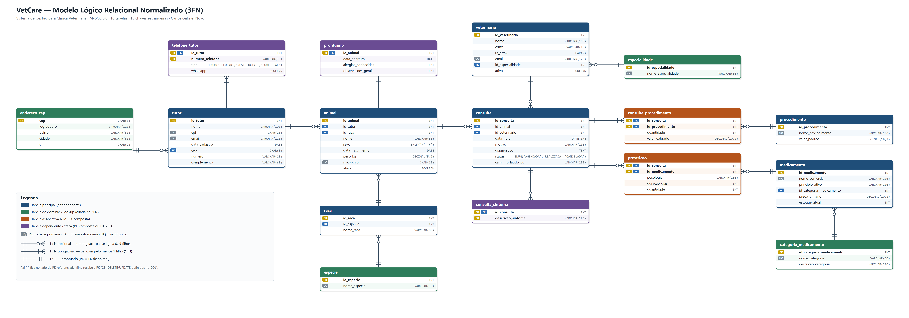

# 03 — Normalização: 1FN → 2FN → 3FN

> Evolução passo a passo das **7 entidades** do DER inicial até as **16 tabelas em 3FN** implementadas em MySQL, com a justificativa formal de cada decisão.

**Navegação:** [01 Minimundo](01-minimundo-e-requisitos.md) · [02 Modelo conceitual](02-modelo-conceitual.md) · **03 Normalização** · [04 Dicionário de dados](04-dicionario-de-dados.md)

---

## 0. Pontos de partida e notação

Do DER conceitual derivam-se **6 tabelas preliminares** (mais `prontuario`, já adequada) e as duas associativas dos relacionamentos N:M. Notação: `A → B` lê-se "A determina funcionalmente B"; <u>sublinhado</u> = chave primária.

Definições usadas:

- **1FN:** todos os atributos são **atômicos** (sem compostos, sem multivalorados, sem grupos repetitivos) e há chave primária.
- **2FN:** está em 1FN e **nenhum atributo não-chave depende de parte** da chave primária composta (sem dependência parcial).
- **3FN:** está em 2FN e **nenhum atributo não-chave depende de outro atributo não-chave** (sem dependência transitiva): *a chave, toda a chave e nada além da chave*.

### Tabelas preliminares (derivadas do DER)

```text
tutor(id_tutor, nome, cpf, email, data_cadastro, endereco, telefones)
animal(id_animal, id_tutor, nome, sexo, data_nascimento, peso_kg, microchip, ativo,
       id_raca, nome_raca, id_especie, nome_especie)
prontuario(id_animal, data_abertura, alergias_conhecidas, observacoes_gerais)
veterinario(id_veterinario, nome, crmv, uf_crmv, email, ativo, id_especialidade, nome_especialidade)
consulta(id_consulta, id_animal, id_veterinario, data_hora, motivo, sintomas, diagnostico, status, caminho_laudo_pdf)
procedimento(id_procedimento, nome_procedimento, valor_padrao)
medicamento(id_medicamento, nome_comercial, principio_ativo, preco_unitario, estoque_atual,
            id_categoria_medicamento, nome_categoria, descricao_categoria)
consulta_procedimento(id_consulta, id_procedimento, nome_procedimento, valor_padrao, data_hora, quantidade, valor_cobrado)
prescricao(id_consulta, id_medicamento, nome_comercial, principio_ativo, posologia, duracao_dias, quantidade)
```

> A **idade** do animal e o **valor total** da consulta são atributos **derivados** e nunca são armazenados (evita redundância calculável).

---

## 1. Primeira Forma Normal (1FN)

### 1.1 Auditoria

| Tabela | Atende à 1FN? | Violação encontrada |
|---|:-:|---|
| `tutor` | ❌ | `endereco` guarda *"logradouro, número, bairro, cidade/UF, CEP"* em um só campo (**composto**) e `telefones` guarda vários números em uma coluna (**multivalorado**). |
| `consulta` | ❌ | `sintomas` armazena uma lista (*"vômito, apatia, inapetência"*) — viola a atomicidade. |
| `animal` | ✅ | Valores atômicos e PK definida; a redundância de raça/espécie é tema da 3FN. |
| `veterinario` | ✅ | `crmv` e `uf_crmv` já estão separados; PK simples. |
| `procedimento` | ✅ | Atributos atômicos, PK simples. |
| `medicamento` | ⚠️ parcial | `principio_ativo` de associações (ex.: *Praziquantel + Pamoato de Pirantel*) traz mais de uma substância. Decisão: a atomicidade é **relativa ao uso** — o sistema trata a fórmula como descrição comercial. Se houver consultas por substância isolada, evoluir para `principio_ativo` + associativa (fora do escopo atual). |

### 1.2 Correções aplicadas

| # | Problema | Correção |
|:-:|---|---|
| 1 | `tutor.endereco` (composto) | Dividido em colunas atômicas `logradouro`, `numero`, `complemento`, `bairro`, `cidade`, `uf`, `cep` — permite filtrar e ordenar por cidade/UF/CEP. |
| 2 | `tutor.telefones` (multivalorado) | Nova tabela **`telefone_tutor`**(<u>id_tutor</u>, <u>numero_telefone</u>, tipo, whatsapp), PK composta; **uma linha por telefone**, sem colunas `telefone1`, `telefone2` (grupo repetitivo evitado). |
| 3 | `consulta.sintomas` (multivalorado) | Nova tabela **`consulta_sintoma`**(<u>id_consulta</u>, <u>descricao_sintoma</u>), PK composta, `ON DELETE CASCADE` por ser entidade fraca. |

**Resultado da 1FN:** todas as tabelas com PK, valores atômicos e sem listas ou grupos repetitivos — **2 novas tabelas** (`telefone_tutor`, `consulta_sintoma`) e **7 novas colunas atômicas** em `tutor`.

---

## 2. Segunda Forma Normal (2FN)

A 2FN só atua em tabelas de **chave composta**: `consulta_procedimento`, `prescricao`, `telefone_tutor` e `consulta_sintoma`. Tabelas de PK simples (`tutor`, `animal`, `consulta`…) satisfazem a 2FN automaticamente.

### 2.1 Dependências parciais encontradas

**`consulta_procedimento`** — PK `(id_consulta, id_procedimento)`

```text
id_procedimento           → nome_procedimento, valor_padrao     (parcial)
id_consulta               → data_hora                           (parcial)
(id_consulta, id_procedimento) → quantidade, valor_cobrado      (completa ✔)
```

**`prescricao`** — PK `(id_consulta, id_medicamento)`

```text
id_medicamento            → nome_comercial, principio_ativo     (parcial)
(id_consulta, id_medicamento)  → posologia, duracao_dias, quantidade   (completa ✔)
```

**`telefone_tutor`:** `tipo` e `whatsapp` dependem do número *do tutor* (chave inteira) — já em 2FN.
**`consulta_sintoma`:** toda a tabela é a chave; não há atributo não-chave — já em 2FN.

### 2.2 Correções

| Tabela | Antes | Depois |
|---|---|---|
| `consulta_procedimento` | `(id_consulta, id_procedimento, nome_procedimento, valor_padrao, data_hora, quantidade, valor_cobrado)` | `consulta_procedimento`(<u>id_consulta</u> FK, <u>id_procedimento</u> FK, quantidade, valor_cobrado); `nome_procedimento` e `valor_padrao` ficam em **`procedimento`**; `data_hora` já existe em `consulta`. |
| `prescricao` | `(id_consulta, id_medicamento, nome_comercial, principio_ativo, posologia, duracao_dias, quantidade)` | `prescricao`(<u>id_consulta</u> FK, <u>id_medicamento</u> FK, posologia, duracao_dias, quantidade); `nome_comercial` e `principio_ativo` ficam em **`medicamento`**. |

> `valor_cobrado` **não** é redundante com `valor_padrao`: é o preço efetivamente praticado na data (pode haver desconto) e não pode ser derivado do catálogo.

**Resultado da 2FN:** nenhuma dependência parcial remanescente. Anomalias eliminadas:

- **Atualização:** mudar o preço padrão altera **uma única linha** em `procedimento`.
- **Inserção:** é possível cadastrar um procedimento sem que exista consulta.
- **Exclusão:** apagar uma consulta não apaga o catálogo.

---

## 3. Terceira Forma Normal (3FN)

### 3.1 Dependências transitivas encontradas

| Tabela | Cadeia de dependência | Violação |
|---|---|---|
| `tutor` | `id_tutor → cep → logradouro, bairro, cidade, uf` | atributos descritivos dependem do `cep`, não do tutor. |
| `animal` | `id_animal → id_raca → nome_raca, id_especie` e `id_especie → nome_especie` | raça e espécie repetidas em cada animal. |
| `veterinario` | `id_veterinario → id_especialidade → nome_especialidade` | nome da especialidade repetido. |
| `medicamento` | `id_medicamento → id_categoria_medicamento → nome_categoria, descricao_categoria` | nome/descrição da categoria repetidos. |
| `consulta` | — | todos os atributos dependem apenas de `id_consulta`; `valor_total` é derivado (não armazenado). **Já em 3FN.** |
| `consulta_procedimento` | — | só `quantidade` e `valor_cobrado`, que dependem da chave inteira. **Já em 3FN.** |

### 3.2 Correções: extração para tabelas de domínio com FK

| Dependência transitiva | Nova tabela | Relacionamento resultante |
|---|---|---|
| `cep → logradouro, bairro, cidade, uf` | **`endereco_cep`**(<u>cep</u>, logradouro, bairro, cidade, uf) | `tutor.cep` → FK; `tutor` mantém `numero` e `complemento`. |
| `id_especie → nome_especie` | **`especie`**(<u>id_especie</u>, nome_especie) | `raca.id_especie` → FK. |
| `id_raca → nome_raca, id_especie` | **`raca`**(<u>id_raca</u>, id_especie FK, nome_raca) | `animal` mantém apenas `id_raca` (FK). |
| `id_especialidade → nome_especialidade` | **`especialidade`**(<u>id_especialidade</u>, nome_especialidade) | `veterinario.id_especialidade` → FK. |
| `id_categoria_medicamento → nome_categoria, descricao_categoria` | **`categoria_medicamento`**(<u>id_categoria_medicamento</u>, nome_categoria, descricao_categoria) | `medicamento.id_categoria_medicamento` → FK. |

**Resultado da 3FN:** cada dado descritivo passa a existir em **um único lugar**, sem anomalias de atualização, inserção ou exclusão.

---

## 4. Resultado final: 16 tabelas em 3FN

| # | Tabela | Origem |
|:-:|---|---|
| 1 | `endereco_cep` | 3FN — `cep → logradouro, bairro, cidade, uf` |
| 2 | `tutor` | entidade TUTOR |
| 3 | `telefone_tutor` | 1FN — multivalorado `{telefone}` |
| 4 | `especie` | 3FN — `id_especie → nome_especie` |
| 5 | `raca` | 3FN — `id_raca → nome_raca, id_especie` |
| 6 | `animal` | entidade ANIMAL |
| 7 | `prontuario` | entidade fraca PRONTUARIO |
| 8 | `especialidade` | 3FN — `id_especialidade → nome_especialidade` |
| 9 | `veterinario` | entidade VETERINARIO |
| 10 | `consulta` | entidade CONSULTA |
| 11 | `consulta_sintoma` | 1FN — multivalorado `{sintoma}` |
| 12 | `procedimento` | entidade PROCEDIMENTO |
| 13 | `consulta_procedimento` | 2FN — N:M `executa` |
| 14 | `categoria_medicamento` | 3FN — categoria |
| 15 | `medicamento` | entidade MEDICAMENTO |
| 16 | `prescricao` | 2FN — N:M `prescreve` |

**15 chaves estrangeiras** ligam as tabelas; detalhes de colunas, tipos e restrições em [04 — Dicionário de dados](04-dicionario-de-dados.md).

### Antes → depois

| Preliminar | Depois (3FN) |
|---|---|
| `tutor(endereco, telefones)` | `tutor` + `endereco_cep` + `telefone_tutor` |
| `animal(nome_raca, nome_especie)` | `animal` + `raca` + `especie` |
| `veterinario(nome_especialidade)` | `veterinario` + `especialidade` |
| `medicamento(nome_categoria, descricao_categoria)` | `medicamento` + `categoria_medicamento` |
| `consulta(sintomas)` | `consulta` + `consulta_sintoma` |
| `consulta_procedimento(nome, valor_padrao, …)` | `consulta_procedimento` + `procedimento` |
| `prescricao(nome_comercial, principio_ativo, …)` | `prescricao` + `medicamento` |



## 5. Sobre BCNF e desnormalização consciente

- Todas as tabelas satisfazem também a **BCNF**: em cada uma, todo determinante é chave candidata (as chaves naturais únicas — `cpf`, `crmv+uf_crmv`, `microchip`, nomes de catálogo — coincidem com os determinantes e foram marcadas como `UNIQUE`).
- Não houve desnormalização: com o volume de uma clínica de pequeno/médio porte, o custo dos `JOIN`s extras é desprezível frente ao ganho de integridade. Em um cenário de grande volume, `valor_total` poderia ser materializado — decisão consciente e documentada, não implementada aqui.

---

**← Anterior** [02 — Modelo conceitual](02-modelo-conceitual.md) · **Próximo →** [04 — Dicionário de dados](04-dicionario-de-dados.md)
